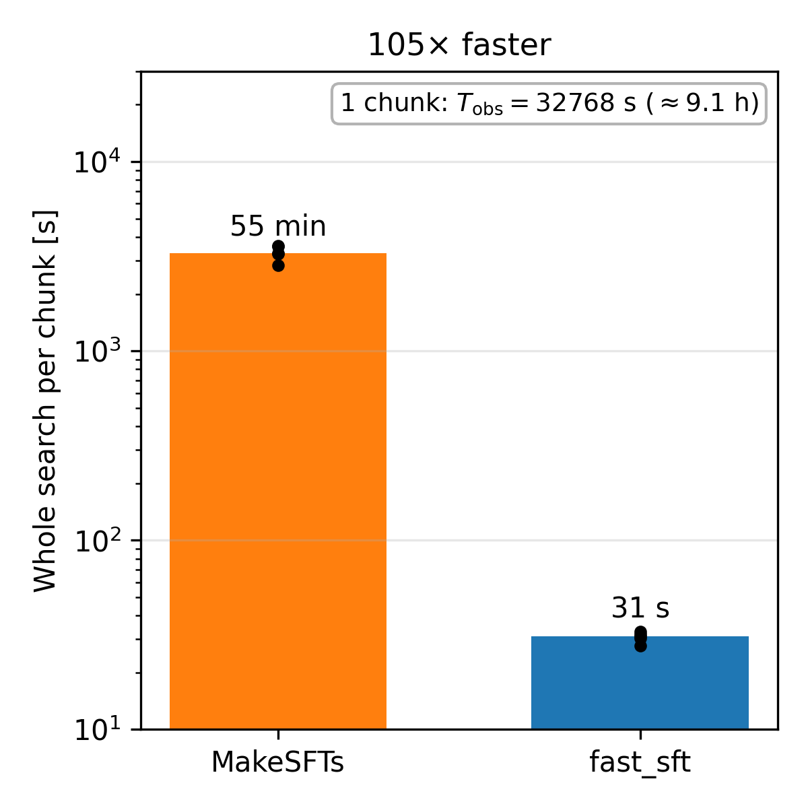

# In-memory SFT generation

From v1.1 the SFTs are built in memory (`pbh_viterbi.sft.fast`) instead of
with `lalpulsar_MakeSFTs`. The maps and the search results are the same, and
a chunk is processed ~100× faster. `--sft-method makesfts` keeps the original
method (integer Tsft only).

## Why

With MakeSFTs, SFT generation took ~97% of the run time: 86 of 89 min per
chunk on the campaign nodes. The cost was not the FFTs, which take under 1 s
for all the SFTs of a chunk. It was the MakeSFTs overhead: it re-reads the
frames for every SFT, runs hundreds of processes, and writes, validates and
reads back ~58000 `.sft` files per chunk.

## What MakeSFTs computes

With the options of the search (`-w rectangular -f FMIN -F FMIN -B BAND`),
MakeSFTs processes each SFT segment independently. It:

1. high-pass filters the segment (10th-order Butterworth, amplitude 0.5 at
   FMIN, `lal.ButterworthREAL8TimeSeries`);
2. FFTs it and multiplies by dt;
3. keeps round(BAND·Tsft) bins starting at bin round(FMIN·Tsft);
4. stores the result in single precision.

`pbh_viterbi.sft.fast.sft_matrix` does the same four steps on the strain array
of the chunk, calling the same LAL filter.

The per-segment filter is essential. Without it, the low-frequency power of
the strain leaks into the search band through the rectangular window.

## Validation

Checked against MakeSFTs on O3b data:

| Test | Result |
|---|---|
| Noise search, 50 random packs, compared with the paper noise results | 45 identical to all digits; 5 differ only in the last digit of the mass or NMSE (relative 1–3×10⁻¹⁶) |
| SFTs, remapped maps and Viterbi tracks, all 13 Tsft, 2 packs + 3 injections (65 maps) | 61 maps bitwise identical; 4 differ in 1–3 pixels out of ≥2×10⁶ by ≤6×10⁻⁸ (one single-precision rounding step, numpy vs FFTW); all 65 tracks identical |
| Injected search, 3 signals near the detection limit (Mc = 1.1×10⁻³, 4.5×10⁻³, 7.1×10⁻² M☉) | identical candidate, nσ, NMSE, mass and Tsft |
| In-memory injection vs writing and reading the injected GWF frames | strain bitwise identical |
| v1.1 workflows, one pack: noise search and one injection, fast vs `--sft-method makesfts` | identical rows |

## Speed and memory

For one 32768 s chunk with the 13 paper Tsft, on an AMD EPYC 9475F node:

| | MakeSFTs (12 processes) | In memory (1 process) |
|---|---|---|
| SFT generation, 13 Tsft | 3270 s (55 min) | 17 s |
| Whole noise search (reading, SFTs, remapping, Viterbi, candidate) | ~55 min | 31 s |
| Peak memory | median 2.0 GB per campaign job, plus disk | 1.6 GB, no disk |

Most of the remaining time is the per-segment Butterworth filter, about 1.2 s
per Tsft and chunk whatever the Tsft. The cost of a search therefore grows
linearly with the number of Tsft (`docs/computational_cost.md`).
