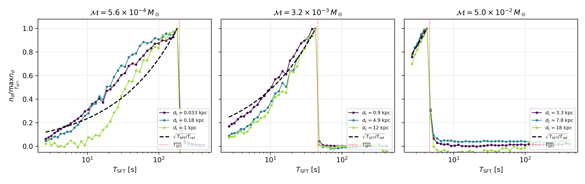

# SFT durations for the remapped search

The search tracks the signal in the remapped (t, f⁻⁸ᐟ³) map. There, the best SFT
duration is set by how fast Viterbi can follow the signal, not by Eq. (14) of
the paper. The full derivation and its validation are in
[`tools/opt_tsft_remapped/nsigma_derivation.pdf`](../tools/opt_tsft_remapped/nsigma_derivation.pdf).

## Tracking limit

In x = f⁻⁸ᐟ³ an inspiral moves at constant speed
K = (256/5) π^(8/3) (G𝓜/c³)^(5/3). The band [f₀, f₁] (width B) is remapped onto
B·Tsft points equally spaced in x. With the transition matrix of the search,
Viterbi moves at most one bin per step, so it can follow the signal only if

    Tsft ≤ T_lim = sqrt((f₀^-8/3 − f₁^-8/3) / (K B)) = sqrt(Δτ_band / B)
         ≈ 17.7 s (𝓜 / 10⁻² M☉)^(-5/6)        (61.1–126.8 Hz),

where Δτ_band is the time the signal takes to cross the band. This is
Eq. (12) of the paper with ḟ at f₁ replaced by the mean ḟ over the band, and it
gives SFTs ≈ 2.1× longer than Eq. (14).

The paper requires the signal to stay in one *linear* frequency bin per SFT.
In the remapped map the relevant bin is the *remapped* one: the shift of the
signal within one SFT equals s times the local width of a remapped bin, where
s is the drift per step, so both conditions become s ≤ 1.

## nσ as a function of chirp mass and Tsft

Following arXiv:2401.02314, with nσ ∝ ρ²/√N_SFT and N_SFT = T_obs/Tsft, and
with the whole band tracked for Tsft ≤ T_lim:

    nσ(𝓜, Tsft) / max nσ = sqrt(Tsft / T_lim)   for Tsft ≤ T_lim,   0 above.

The best Tsft of a list is the largest one ≤ T_lim (`pbh_viterbi.tsft`).

## Validation with injections

* **Selection rule.** For 10 chirp masses from 4.5×10⁻³ to 0.1 M☉ (100
  injections), the selected Tsft is the largest grid value ≤ T_lim in 99/100.
  The miss is a signal not detected at all.
* **Sharp cutoff.** The next Tsft above T_lim keeps 0–28% of the maximum nσ.
  The cutoff is not exact at the percent level: Mc = 0.085 M☉, where
  T_lim = 2.98 s, still selects 3 s.
* **Shape near the optimum.** This was measured with the dense 45-Tsft list,
  for 3 masses × 5 distances × 3 packs, in T_ref/3 ≤ Tsft ≤ T_ref:
  * the measured nσ follows sqrt(Tsft/T_ref) within 0.09 for 5.0×10⁻² M☉;
  * within 0.17 (mean < 0.04) for 3.2×10⁻³ M☉;
  * it lies above the curve (by 0.10–0.15 on average) for 5.6×10⁻⁴ M☉.

  The expression is therefore accurate for heavy and intermediate masses and
  conservative for light ones. Far below T_lim, nσ falls faster than sqrt(Tsft)
  for weak signals, but those Tsft are never selected.
* **Tsft = 1 s.** It was tested on 900 injections of Mc = 0.085 M☉ in the 30
  paper packs and does not help: it was selected in 10/900 cases, all driven by
  noise features in two packs, and it gives about half the nσ of Tsft = 3 s.

## Tsft lists

`config.TSFT_LISTS` holds the smallest sets, in multiples of 1/8 s, that keep
nσ / max nσ above a threshold for every chirp mass in [2×10⁻⁴, 0.1] M☉
(`tools/opt_tsft_remapped/compare_tsft_lists.py`). Choose the list with
`--tsft-list` (default `95`).

| List | N Tsft | Range (s) | nσ / max: worst / mean | Reach: worst / mean | Core-hours, 18000-injection campaign |
|---|---|---|---|---|---|
| `95` | 45 | 2.6–422 | 0.947 / 0.978 | 0.94 / 0.975 | ~380 |
| `90` | 24 | 2.6–377 | 0.897 / 0.954 | 0.88 / 0.948 | ~220 |
| `paper` | 13 | 2–88 | 0.44 / 0.85 | 0.39 / 0.83 | ~140 |

The reach is converted with nσ ∝ d⁻⁰·⁸⁷, measured on injections (the map uses
|SFT|, not |SFT|²). Going from 95% to 90% halves the cost and loses at most 6%
of reach (3% on average). The paper list stops at 88 s, while T_lim reaches
460 s at 2×10⁻⁴ M☉, which limits its sensitivity to light masses.
