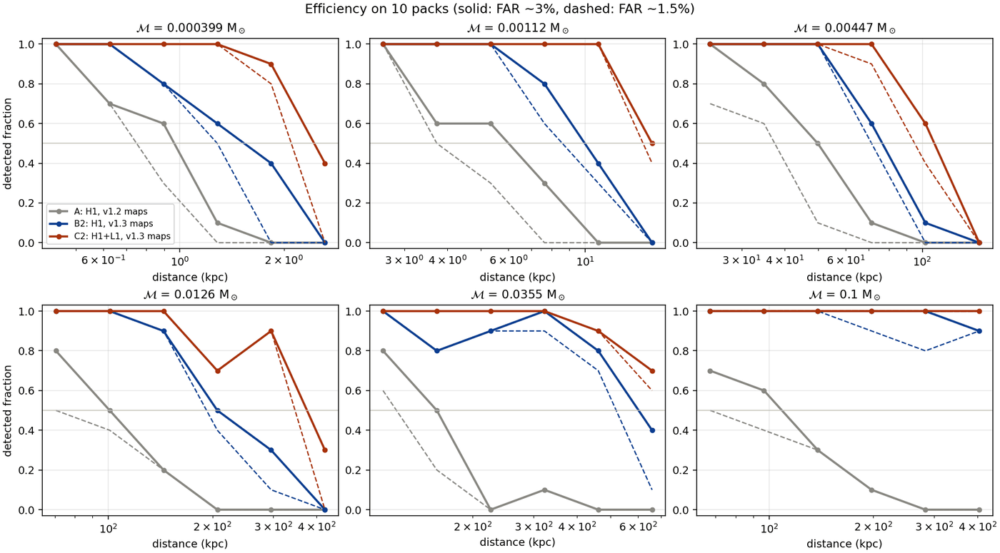
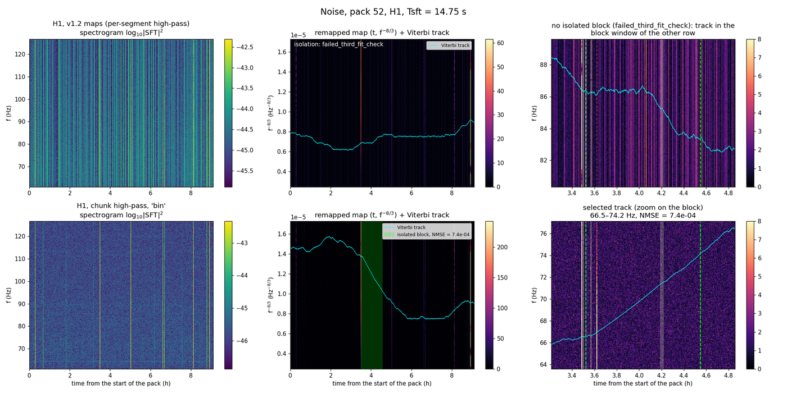
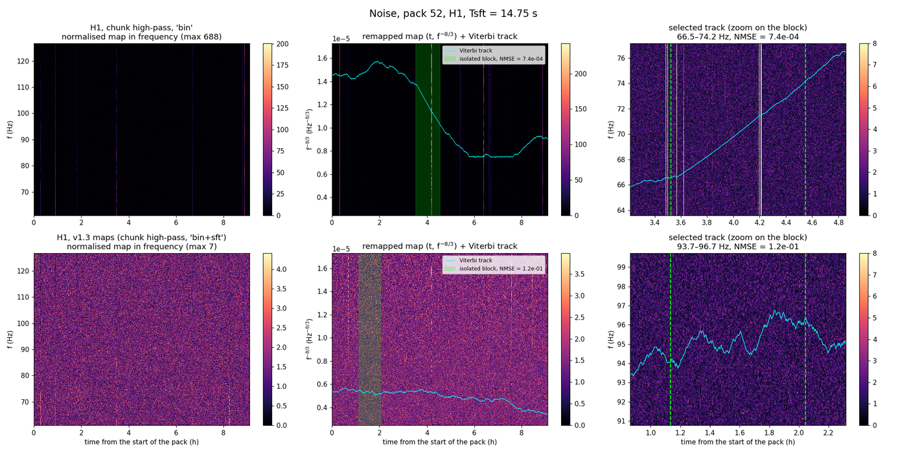

# Multi-detector study (H1 + L1) and the v1.3 maps

This study added three options to the search and made two of them the default in v1.3:

| Option | Default | What it does |
|---|---|---|
| `--sft-highpass chunk` | yes (v1.3) | high-pass the strain of the whole chunk once, instead of every SFT segment |
| `--map-normalisation bin+sft` | yes (v1.3) | after the per-bin normalisation, divide every SFT by its median over the band |
| `--detectors H1 L1` | no (H1) | sum the normalised maps of both detectors and track them once |

The v1.2 maps are `--sft-highpass segment --map-normalisation bin`.

## Why the SFT changed

* **Spectral leakage.** The per-segment high-pass (as `lalpulsar_MakeSFTs`) with a
  rectangular window puts the filter start transient of every segment into the
  61–127 Hz band. The noise floor of the maps ends up ×1.5–6 above the PSD in H1 and ×3–17
  in L1; with the chunk high-pass it is 0.85–0.95 of the PSD. This limited every H1
  result up to v1.2 (paper and v1.2 campaign).
* **Broadband glitches.** With the leakage gone, short broadband glitches in H1 become
  visible. The Viterbi track jumps between them and drifts like a chirp
  (NMSE ~5×10⁻⁴). Noise packs 52 and 27 set the threshold this way. Dividing every SFT by
  its median over the band flattens them (R ≈ 9 → 0.5) and keeps the signal, which
  fills only a few bins of an SFT. The spread of the noise between packs (σ/μ)
  drops ×1.5–10.

## How H1 and L1 are combined

* Each detector's |SFT| map is normalised on its own (per bin, then per SFT), so a
  different noise level in each detector cancels.
* The normalised maps are summed and divided by √N. The pixel noise then fluctuates as
  in one map, and the Viterbi transition prior keeps its weight.
* The sum is remapped and tracked once: one track, one Tsft selection and one nσ per
  chunk, with the nσ background of the H1+L1 configuration.
* Injections generate h₊ and hₓ once and project them on each detector (antenna
  pattern and arrival-time delay). The frequency offset between the detectors
  (Doppler, delay) is far below one bin for these signals, so the signal falls in the
  same pixel of both maps.

**Limitation: both detectors need data on the same chunk.** The maps are summed bin
by bin, so the SFTs must start at the same GPS times. Only **61 of the 141** H1 chunks
also have L1 data with 100% duty cycle (`calibration/l1_packs.txt`, from
`l1_coverage.py`). The other 80 can only be searched with H1. Each configuration
(detectors, high-pass, normalisation) needs its own nσ background and threshold, so
H1 and H1+L1 chunks cannot share them.

## Quick efficiency test

* 36 signals (`quick_signals.csv`): 6 chirp masses from 4×10⁻⁴ to 0.1 M☉ × 6
  distances.
* Injected in 3 calibration packs (104, 113, 126, which set *a* of
  R = nσ − a log₁₀ NMSE_eff) and 10 evaluation packs (360 injections per
  configuration).
* The threshold on R is set on the noise of the 61 packs with L1, with at most one
  noise pack above it (FAR ~3%) or none (FAR ~1.5%).

Efficiency on the evaluation packs, with a 68% bootstrap interval over the noise packs:

| Configuration | FAR ~3% | FAR ~1.5% |
|---|---|---|
| A: H1, v1.2 maps | 33% [24–34] | 24% [24–33] |
| B: H1, chunk high-pass, `bin` | 48% [45–55] | 45% [45–48] |
| C: H1+L1, chunk high-pass, `bin` | 73% [70–76] | 70% [70–73] |
| **B2: H1, v1.3 maps** | **73% [67–76]** | **67% [67–73]** |
| **C2: H1+L1, v1.3 maps** | **89% [85–89]** | **85% [85–89]** |

* **Paired injections at FAR ~3%** (detected only by the first / only by the second):
  B2 vs A 144/1, C2 vs A 200/0.
* **Distance of 50% detection (d₅₀) relative to A at FAR ~3%:** ×1.5–3.8 for B2 and
  ×2.2–3.7 for C2, depending on the mass. For the heaviest masses the efficiency stays
  above 50% at every distance tested, so there is no ratio.



The per-segment high-pass raises the noise of the maps (pack 52, top: v1.2 maps,
bottom: chunk high-pass):



With the chunk high-pass, the per-SFT normalisation removes the broadband glitches
the track followed:



### Limits

* The noise has only 61 packs and no time slides, so the tail of the noise distribution
  is not certified.
* With the v1.3 maps the threshold is set by noise packs 67 (Tsft 11.6 s) and 95
  (Tsft 374 s, NMSE 1.5×10⁻⁴). They have not been inspected yet.
* There are 10 injections per distance, so d₅₀ is uncertain by ±20–30%.
* The best *a* on the 3 calibration packs is 1 for the v1.3 maps, while v1.2
  uses a = 2. *a* and the threshold must be recalibrated for a v1.3 campaign.

## Reproducing

From a clone the cluster nodes can read:

```bash
python studies/multi_detector/l1_coverage.py                    # -> calibration/l1_packs.txt
python -m pbh_viterbi.o3.download --ifo L1 --packs <L1 packs>   # L1 frames into the same pack folders
NORM=bin+sft bash studies/multi_detector/submit_quick_test.sh background   # nσ backgrounds, 61 packs
# then analysis/noise_background_stats.py with the same map options (see submit_quick_test.sh)
NORM=bin+sft bash studies/multi_detector/submit_quick_test.sh               # noise and injections
python studies/multi_detector/quick_test.py --configs A B2 C2 --a-noise <v1.2 campaign>/per_tsft_noise.csv
python studies/multi_detector/plot_pairs.py
```
